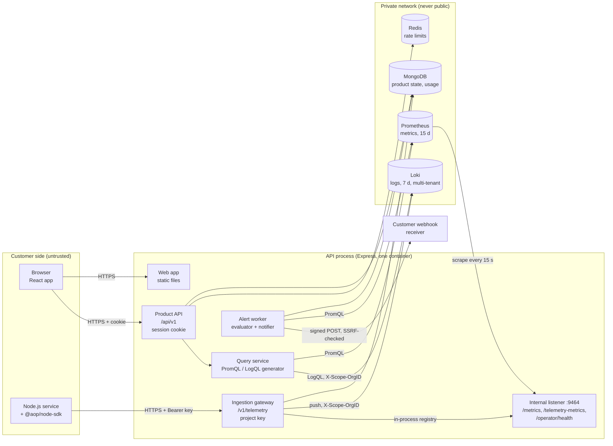
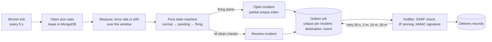

# Architecture

This document describes the system as it is built: components, data flow, the tenancy model,
storage choices, and how each part behaves when something fails. Security controls are listed in
[`threat-model.md`](threat-model.md). The ingestion contract is in
[`ingestion-api.md`](ingestion-api.md), and the full API is in [`openapi.json`](openapi.json).

## Components



| Component | Code | Role |
|---|---|---|
| Web app | `apps/web` | React SPA served by the API from the same origin, so the session cookie stays first-party |
| Product API | `apps/api/src/modules/*/…routes.ts` | Auth, organizations, projects, keys, queries, alerts, destinations, usage |
| Ingestion gateway | `modules/ingestion`, `modules/telemetry` | Key authentication, validation, redaction, quota, routing to Loki and the metrics registry |
| Query service | `modules/query` | Turns allow-listed descriptors into tenant-scoped PromQL/LogQL |
| Alert worker | `modules/alerts` | Evaluates rules, opens/resolves incidents, delivers webhooks from an outbox |
| Internal listener | `internal-app.ts` | Prometheus scrape target and operator report; port never published |
| SDK | `packages/node-sdk` | Express middleware + logger; bounded batching and retries |
| Shared schemas | `packages/validation` | Zod schemas used by the API, the web forms, and the OpenAPI generator |

The OpenTelemetry Collector runs in the Compose stack, but the platform does not route telemetry
through it yet. The SDK sends the platform's own JSON contract to the gateway. OTLP ingestion is
on the [roadmap](future-roadmap.md).

## Data flow

### 1. Ingestion

```mermaid
sequenceDiagram
  participant SDK as SDK (customer service)
  participant G as Gateway
  participant DB as MongoDB
  participant L as Loki
  participant Reg as Metrics registry
  participant P as Prometheus

  SDK->>G: POST /v1/telemetry/batch (Bearer aop_<id>.<secret>)
  G->>G: verify key (HMAC, 30 s cache) → org, project, environment
  G->>G: validate records, normalize routes, redact secrets
  G->>DB: reserve quota (conditional $inc on today's org counter)
  alt over quota
    G-->>SDK: 429 QUOTA_EXCEEDED, Retry-After = seconds to 00:00 UTC
  end
  G->>L: push logs, X-Scope-OrgID = organizationId
  alt Loki fails
    G->>DB: release the reservation
    G-->>SDK: 503 (nothing recorded; safe to retry)
  end
  G->>Reg: observe request metrics (labels from the key)
  G->>DB: per-project usage counters
  G-->>SDK: 202 {accepted, rejected, errors}
  P->>Reg: scrape /telemetry-metrics every 15 s
```

Tenant identity comes **only** from the key record. Tenant fields in the body and a
client-supplied `X-Scope-OrgID` are ignored. Metric series carry `organization_id` and
`project_id` labels set by the gateway, and Loki streams are written under the organization's
tenant with a `project` label.

### 2. Exploration (dashboards and log search)

The browser sends a descriptor such as `{ metricKey: "p95_latency", range: "1h" }`. The query
service resolves the project scope from the session and a membership lookup, then generates the
query with `organization_id`/`project_id` as the first matchers (PromQL), or with the
organization as the Loki tenant and a mandatory `project` matcher (LogQL). The browser can never
send query text: strict schemas reject unknown fields with `400`.

### 3. Alerting



- **No data** (zero requests) counts as non-breaching and never opens an incident.
- **A failed metrics query** sets the rule to `error` and leaves incidents unchanged.
- **One incident per episode**: a partial unique index allows one firing incident per rule, even
  with several evaluators running.
- **Notifications are decoupled**: a slow or dead receiver never delays evaluation, and a failed
  delivery never changes the incident.

### 4. Quotas and usage

The organization's daily counter (`orgUsageDaily`, one document per org per UTC day) is the
source of truth. A reservation is a single conditional atomic update, so concurrent batches
cannot together exceed the limit. Per-project `usageDaily` documents are a breakdown for the
Usage page. Details: [ingestion-api.md](ingestion-api.md#daily-quota).

## Tenancy model

| Layer | How the tenant is fixed | Where it is enforced |
|---|---|---|
| Browser → API | Session → user; `:organizationId`/`:projectId` checked against an active membership (`TenantScope`). Non-members get `404`. | `authz/tenant-scope.ts` |
| Roles | `owner` / `member`, one policy function (`can(role, action)`) | `authz/policy.ts` |
| MongoDB | Every tenant-owned query filters by `organizationId` from the scope (and `projectId` for project data) | each service |
| SDK → gateway | Key → organization, project, environment. Body/header tenant fields are ignored. | `api-keys/key-authenticator.ts` |
| Loki | Organization = Loki tenant (`auth_enabled: true`); the gateway sets `X-Scope-OrgID` | `loki-writer.ts`, `backend-clients.ts` |
| Prometheus | Not tenant-aware itself: isolation rests on gateway-set labels plus generated matchers, with the API as the only query path | `promql.ts` |
| Alerts | The query scope is taken from the rule record, never from a request | `alert-evaluator.ts` |
| Operator | Not a tenant role: a deployment token, aggregates only | `operator/` |

The mandatory isolation suite (PRD §14.2) is `apps/api/src/test/isolation/`.

## Storage choices

| Data | Store | Why |
|---|---|---|
| Users, sessions, organizations, projects, key hashes, rules, incidents, destinations, outbox, usage | MongoDB | Documents with clear ownership; unique and partial indexes give the atomicity guarantees (one incident, one job, quota) without transactions |
| Rate-limit windows | Redis | Shared, short-lived counters with expiry. Not durable state: losing Redis loses only rate-limit windows. |
| Request metrics | Prometheus | Purpose-built time-series store; histograms give p50/p95/p99 |
| Logs | Loki | Cheap log storage indexed by a few labels, with native multi-tenancy |

Customer telemetry is never stored in MongoDB. Labels are bounded: routes are normalized
templates, capped per project (extra values go to `__other__`), and request IDs live in Loki
structured metadata, not labels.

## Retention

| Signal | Setting | How it is enforced | Verified |
|---|---|---|---|
| Logs | 7 days (`limits_config.retention_period: 168h`) | Loki compactor with `retention_enabled: true` | `npm run check:retention`: a short profile (24 h, Loki's minimum) shows expired logs deleted and fresh ones kept |
| Metrics | 15 days (`--storage.tsdb.retention.time=15d`) | Prometheus deletes whole TSDB blocks (~2 h each) older than the limit | Described, not observable in a short test (PRD §16) |
| Product data | Until deleted | Deleting a project soft-deletes it and revokes every key immediately | Tested |

Retention is deployment-wide in the MVP and shown read-only on the Usage page. Deleting a
project stops new writes at once, but its existing telemetry stays until backend retention
removes it. Deletion is deferred, not instant.

## Failure handling

| Failure | Behaviour |
|---|---|
| MongoDB down | Readiness `not_ready` (503). Product API errors with a request ID. Ingestion fails closed (`503 QUOTA_UNAVAILABLE`), because quota cannot be checked; keys already cached still authenticate. |
| Redis down | Rate limits fail open (logged) so users are not locked out; readiness reports it |
| Loki down | Ingestion returns `503 BACKEND_WRITE_FAILED`, records nothing, and releases quota; the SDK retries with backoff. Log search returns `503 QUERY_BACKEND_UNAVAILABLE`. |
| Prometheus down | Dashboards return `503`. Alert rules go to `error` with incidents untouched. Metrics already accepted stay in the gateway registry until the next scrape. |
| API restart | Product state is in MongoDB. Metrics observed but not yet scraped (≤ 15 s) are lost, a documented pull-model limitation. Outbox jobs and rule leases survive restarts. |
| Webhook receiver down or slow | 5 s timeout, retries at 30 s / 2 m / 10 m / 30 m, every attempt recorded. The incident is unaffected. |
| SDK cannot reach the API | Bounded buffer, retries with jitter, then drops counted in `stats()`. Never throws into the host app. |
| Over quota | `429 QUOTA_EXCEEDED`; the SDK drops instead of retrying until the reset |

Every external call has a deadline (`BACKEND_TIMEOUT_MS`, `WEBHOOK_TIMEOUT_MS`,
`HEALTH_CHECK_TIMEOUT_MS`).

## Self-monitoring

- `/health/live` (no dependencies) and `/health/ready` (every dependency, with latency).
- Internal Prometheus metrics (`aop_*`): request count/latency by route template, ingestion
  accepted/rejected records and bytes, quota rejections, backend call outcomes and latency, alert
  evaluations, webhook attempts, and dependency probe failures. Labels are bounded enumerations
  only.
- Operator view (`/operator`, token-protected), with the same report on the internal listener.

## Deployment shapes

| Shape | Files | What runs where |
|---|---|---|
| Local development | `infra/compose.yaml` | Backends in Docker (ports on 127.0.0.1); API and web on the host |
| Full-stack production (one host) | `infra/compose.prod.yaml` | Everything in Docker; only the app port is published; backends on an internal network with no outside route |
| Hosted demo (Render free tier) | `Dockerfile` | App on Render; MongoDB Atlas; Render Key Value. Prometheus and Loki are not hosted, so metrics and logs report "not configured". |

Details: [deployment.md](deployment.md).

## Scaling notes (beyond the MVP)

The API is stateless apart from the in-process metrics registry. Several instances can run
behind a load balancer: rate limits are in Redis, alert work is lease-based, and quota is atomic
in MongoDB. Each instance must be scraped by Prometheus, because the registry is per process.
The next steps would be remote-write or OTLP into a tenant-aware metrics store (Mimir), and a
queue in front of Loki for burst absorption. See the [roadmap](future-roadmap.md).

## Deviations from the PRD (recorded)

| Topic | PRD | Built | Reason |
|---|---|---|---|
| Quota counters | Redis counters with periodic reconciliation allowed | One MongoDB counter per org per day | One source of truth, with no reconciliation to get wrong; ample for the target load |
| Dashboards | Configurable dashboards (custom builder is P0-stretch) | One fixed project dashboard | Stretch item; the plan's `maxDashboards` is stored but unused |
| Operator view | Internal or operator-authenticated | Both: token on the public route, no token on the internal listener | Usable on a host without private-network access |
| Platform self-telemetry via OTel Collector | P1 (SELF-005) | Collector present, not wired | P1 |
