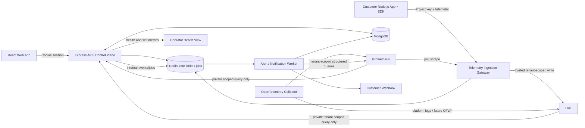

# Product Requirements Document (PRD)

## Application Observability Platform

**Document type:** Implementation-ready product requirements and technical specification  
**Version:** 1.1 (senior-review revision of 1.0; see Appendix B for the change log)  
**Status:** Reviewed working specification based on discovery answers and end-term project guidelines  
**Audience:** Claude/Codex or another coding agent implementing the project; student project owner; evaluator  
**Project type:** Solo end-term software project; production-oriented SaaS design implemented in phases  
**Deadline context:** End-term submission deadline is 27 October 2026, 11:59 PM IST. The deadline is a constraint for the submission MVP, not for the entire long-term roadmap.

---

## 0. How to Use This PRD

This document is the source of truth for implementation. It deliberately distinguishes:

- **Confirmed decisions:** Explicitly selected by the project owner.
- **Adopted implementation defaults:** Concrete technical decisions selected to make the requirements implementable. They are documented here and must not be silently changed by the coding agent.
- **Later-phase requirements:** Part of the broader product roadmap, but not required to be complete for the submission MVP.

The coding agent must not silently broaden the MVP, replace real application logic with mock data, claim tests passed without running them, or mark a feature complete when its acceptance criteria are not met. If an external provider, credential, cost, or infrastructure constraint blocks a requirement, implement the documented local/development alternative and explain the limitation in the final implementation report. Do not invent credentials.

### Implementation rules for the coding agent

1. Read this entire PRD before editing the repository.
2. Inspect the repository and report the existing structure before making destructive changes. Preserve working code where possible.
3. Create a short implementation checklist mapped to the milestones in Section 6.1.
4. Implement one end-to-end workflow at a time. Prefer complete workflows to disconnected features.
5. Use real persistence and real backend calls for all MVP workflows. Mock data may be used only for explicitly labelled preview/demo fixtures and tests.
6. Keep secrets in environment variables. Commit `.env.example`, never real credentials.
7. Keep Prometheus, Loki, MongoDB, Redis, and the OpenTelemetry Collector private to the Docker network; do not publish their ports publicly in production configuration.
8. Every customer telemetry write and read must be tenant-scoped server-side. Never trust a tenant identifier supplied in a request body, query string, label, or header.
9. Do not expose arbitrary raw PromQL or LogQL to customers in the submission MVP. Use validated structured query definitions and server-generated backend queries.
10. After each milestone, run relevant lint, type-check, and tests. Report commands and actual outcomes.
11. Use meaningful incremental Git commits throughout development. Do not make one final commit containing the whole project.
12. If the remaining time makes all roadmap features impossible, complete the MVP acceptance criteria first and document deferred items accurately.

---

## 1. Executive Summary

The Application Observability Platform is a developer-facing SaaS that helps teams monitor Node.js applications by collecting application metrics and structured logs, exploring those signals through dashboards and searches, and receiving alerts when defined conditions occur. Distributed tracing is part of the product roadmap but is explicitly deferred until after the metrics-and-logs MVP.

The platform will provide an authenticated web interface, organizations and projects, project ingestion credentials, a small TypeScript Node.js SDK, telemetry ingestion, tenant-aware metrics and log queries, basic dashboards, alert rules, incidents, notifications, usage controls, retention, and self-monitoring.

The architecture is hybrid. The project owns the SaaS product layer and security boundary: identity, organizations, projects, API keys, quota enforcement, structured query APIs, alert workflows, dashboards, and developer tooling. It uses established infrastructure where that avoids recreating mature storage engines: Prometheus-compatible metrics storage/querying, Grafana Loki for logs, an OpenTelemetry Collector for platform telemetry and future OTLP integration, MongoDB for product metadata, and Redis where rate-limiting or background jobs benefit from it. Tempo is a later-phase trace backend.

The end-term delivery is intentionally narrower than the full product roadmap. It must demonstrate complete workflows rather than advertise unfinished features. The full product scope remains documented in this PRD as phased follow-on work.

## 2. Confirmed Decisions and Adopted Defaults

### 2.1 Confirmed by the project owner

- Goal: production-oriented SaaS, developed as a solo end-term project.
- Monitored applications: Node.js first; broader standard OTLP ingestion support later.
- Telemetry scope: metrics and logs in the MVP; distributed traces in a later release.
- Infrastructure approach: hybrid—build the SaaS/product logic and selected ingestion logic, use specialized infrastructure where justified.
- Product stack: MERN plus infrastructure tools where justified.
- Tenancy: shared infrastructure with enforced tenant isolation.
- Deployment: cloud-agnostic Docker deployment, local development and cloud deployment.
- Authentication: email/password initially; OAuth later.
- Language: TypeScript across the application.
- Product scope: selected features delivered in phases.
- Billing: usage quotas and plan limits; no real payments.
- Team size: one developer.
- Performance ambition: 1,000 telemetry events/second sustained and a short 5,000 events/second burst, with measurable load tests.
- Retention: configurable, sensible defaults.
- Submission deadline: 27 October 2026, 11:59 PM IST, per the uploaded guidelines.

### 2.2 Adopted implementation defaults

These defaults make the product implementable and are intentionally stated rather than left implicit.

| Area | Adopted default | Rationale |
|---|---|---|
| Submission MVP | Authentication, organization/project/API-key flow, Node.js instrumentation, metrics dashboard, logs explorer, one working alert-to-incident flow, minimal webhook notification, Docker-based setup, tests, README, and demo | Delivers coherent, demonstrable workflows within a very tight deadline |
| Metric backend in MVP | Prometheus, private network only | Keeps the selected stack and limits operational complexity; tenant isolation is enforced by the product query API and restricted query model |
| Metric query interface | Structured/allow-listed query definitions; no customer-supplied raw PromQL in MVP | Prevents cross-tenant query escape and unbounded queries against shared Prometheus |
| Logs backend | Loki multi-tenant mode with tenant = organization; the trusted gateway determines and overwrites `X-Scope-OrgID`, and every query adds a mandatory server-injected project matcher | Loki expects a tenant ID on requests in multi-tenant mode, and its documentation assigns responsibility for populating it to a trusted proxy/gateway ([Loki authentication](https://grafana.com/docs/loki/latest/operations/authentication/)) |
| Collector use | OpenTelemetry Collector handles platform/internal telemetry initially and provides the integration path for standard OTLP ingestion later | Avoids making general-purpose OTLP ingestion a deadline blocker |
| Trace backend | Tempo in a later milestone, configured with multi-tenancy and trusted tenant-header injection | Tracing is explicitly deferred by product decision |
| Product database | MongoDB with Mongoose; each tenant-owned document includes `organizationId`, and project-owned data additionally includes `projectId` | Fits MERN, project scope, and ownership checks |
| Session model | Server-side sessions in MongoDB; `HttpOnly`, `SameSite=Lax`, and `Secure` in production; CSRF/origin protections for mutating requests | Simple browser SaaS model, revocable sessions, avoids long-lived browser-stored bearer tokens |
| API key storage | Show generated key once; store only a cryptographic hash; support revocation and rotation | Limits impact of database exposure |
| MVP roles | `owner` and `member`; future `admin`/`viewer` granular roles can be added later | Enough to demonstrate authorization without overbuilding |
| Quota accounting | Count accepted telemetry records and estimated ingested bytes per project and per organization, with daily UTC windows | Understandable, measurable, and easy to test |
| Plan types | Seeded `Developer` plan plus a configurable plan model; no payment provider | Enables quota logic without billing complexity |
| Default retention | Metrics: 15 days; logs: 7 days; traces when introduced: 3 days | Practical development defaults; configurable within platform-defined bounds |
| Retention owner | MVP: deployment-level settings, shown read-only in the UI. Later: organization owners choose allowed log retention values per plan (Loki per-tenant overrides); metrics retention stays global on a single Prometheus; platform defaults cannot be disabled by customers | Prometheus retention is a single global setting, not per tenant; also avoids unlimited storage and uncontrolled costs |
| Alert conditions | Error-rate threshold and latency threshold using predefined metric types; user-defined threshold/window within safe bounds | Demonstrates meaningful application logic while keeping queries safe |
| Dashboard model | Versioned JSON schema stored in MongoDB; widgets select approved metric queries or log filters | Supports custom dashboards without exposing backend query engines |
| SDK/CLI MVP | TypeScript Node SDK with Express middleware, structured logger, batch sender, and a tiny CLI for test telemetry/connection validation | Gives users a genuine integration workflow; more CLI commands are later-phase work |
| Notification MVP | Webhook notification with SSRF protections; email notification via configured SMTP in a later MVP extension if credentials are available | Avoids hard dependency on an external email provider while preserving an extension path |
| Cloud hosting | Provider-neutral Docker Compose deployment for local development and a documented Linux Docker host deployment path; do not assume free hosting can run every backend | Keeps provider choice open; deployment credentials and budget were not supplied |
| Load benchmark | Targets are measured engineering goals, not a hard submission gate; actual throughput and latency must be reported honestly | Performance depends on hardware, signal mix, payload size, and deployment limits |

### 2.3 Important Prometheus tenancy constraint

Prometheus is not treated as an independently authenticated tenant-aware customer API. Its endpoint must remain private, and the application API must be the only customer query path. In the MVP, dashboards and alert rules use a validated structured query model that generates tenant-scoped PromQL on the server. The server derives `organizationId` and `projectId` from the authenticated session or verified API key and includes those scopes in every generated query. It rejects unknown metric names, unsupported dimensions, arbitrary expressions, and unbounded time ranges. Integration tests must prove that organization A cannot retrieve organization B's data.

This is a constrained MVP design, not a claim that a standalone Prometheus server is a complete multi-tenant SaaS metrics service. If unrestricted PromQL, a large tenant count, or stronger native metrics tenancy becomes a requirement, evaluate a Prometheus-compatible multi-tenant backend such as Grafana Mimir. Mimir uses `X-Scope-OrgID` for tenant-scoped requests and still expects a trusted authentication layer to set that identity ([Mimir authentication and authorization](https://grafana.com/docs/mimir/latest/manage/secure/authentication-and-authorization/)). The coding agent must not add raw PromQL to the MVP as a shortcut.

---

## 3. Problem Statement

Developers of Node.js applications need a practical way to determine whether their services are healthy, identify slow or failing endpoints, search errors, and receive actionable notifications. Ad hoc console logs and disconnected charts make it difficult to associate application behavior with a specific service or time window.

The product provides one place where a developer can register a project, instrument a Node.js application, observe request metrics, search structured logs, configure alert conditions, and investigate incidents. It is a software product—not a static dashboard—and must process real telemetry from a running sample application.

## 4. Target Users and Personas

### 4.1 Independent developer

- Owns one or more Node.js services.
- Wants a quick integration with minimal configuration.
- Needs to inspect request rates, latency, errors, and logs.
- Values a useful local setup and clear SDK examples.

### 4.2 Small-team owner

- Creates an organization and projects.
- Generates/revokes project credentials.
- Grants another user access to the organization (post-MVP via invitations; seeded test users in the MVP).
- Configures usage limits and alert rules.

### 4.3 Team member

- Can view dashboards, search telemetry, and inspect incidents for all projects in the organization (per-project assignment is a later-phase role feature).
- Cannot change organization ownership, manage other users, or reveal API secrets.

### 4.4 Platform operator (developer/admin)

- Needs health endpoints, service metrics, structured logs, queue/ingestion information, and benchmark results.
- Must diagnose platform failures without needing customer credentials.

## 5. Goals and Success Criteria

### 5.1 Product goals

1. Provide an end-to-end Node.js instrumentation-to-dashboard workflow.
2. Persist identity, organization, project, dashboard, alert, incident, and usage metadata.
3. Provide useful metrics and log exploration based on real ingested data.
4. Enforce shared-infrastructure tenant isolation at ingestion and query time.
5. Demonstrate meaningful product logic beyond CRUD: quotas, alert state transitions, notification deduplication, and retention.
6. Be reproducible locally using Docker Compose and have a documented public deployment path.
7. Have a complete repository, meaningful Git history, tests, README, architecture documentation, and a 3–5 minute demonstration.

### 5.2 Submission success criteria

The submission MVP is successful only if the following workflows operate end to end with real application data:

- A user can register/login and create or access an organization.
- The user can create a project and rotate/revoke an ingestion key.
- A Node.js sample app instrumented with the SDK sends request metrics and structured logs.
- The dashboard displays those metrics and the log explorer retrieves the corresponding logs.
- A user can create a supported alert, trigger it with test traffic, see an incident transition, and receive a webhook or view a clearly reported delivery configuration state.
- Tenant-isolation tests pass for both metadata APIs and telemetry queries.
- The application starts from documented Docker instructions, with persistent data volumes and environment-variable configuration.
- The README, tests, load-test report, deployment notes, and demo plan are present.

### 5.3 Non-goals for the submission MVP

- Full production-grade HA, multi-region replication, auto-scaling, or Kubernetes orchestration.
- A general-purpose replacement for Prometheus, Loki, or OpenTelemetry Collector.
- Customer-facing arbitrary PromQL or LogQL execution.
- Distributed tracing in the MVP.
- Multi-language SDKs in the MVP.
- Real payment processing or subscription billing.
- A guarantee that the moderate throughput targets are achieved on all machines.
- A public service with a security certification or compliance claim.

---

## 6. Scope and Phasing

### Phase 0 — Submission MVP (highest priority)

**Goal:** Deliver 3–5 complete, testable user workflows for the end-term submission. Do not attempt to complete every later-phase feature before the MVP is reliable.

#### Required capabilities

1. Email/password signup, login, logout, and secure session handling.
2. Organization creation on signup, organization membership, owner/member roles, project creation, and project API key creation/revocation.
3. TypeScript Node SDK for Express request metrics and structured logs; a sample Node.js service must use the SDK.
4. Authenticated telemetry ingress; server-generated organization/project scope; bounded batching and payload validation.
5. Prometheus-backed metrics summary and time-range chart using a safe, structured query API.
6. Loki-backed log search with time range, severity, service, and trace/request correlation field filters (trace functionality is not required yet; request IDs may be used).
7. At least two alert conditions: high error rate and high latency; incident lifecycle and deduplicated webhook notification.
8. Basic quota accounting and enforcement for events/bytes; clear `429` response when the configured limit is exceeded.
9. Basic platform self-monitoring: health/readiness endpoints, API request/error metrics, telemetry-accepted/rejected counts, and ingestion-latency visibility.
10. Docker Compose local environment, automated tests, `.env.example`, README, architecture diagram, benchmark script/report, and 3–5 minute demo plan.

#### MVP may defer if needed to preserve workflow correctness

- Rich dashboard drag-and-drop layout editor; provide a small custom-dashboard builder with a limited set of supported widgets instead.
- SMTP email notifications; webhook notification is the required notification path, and SMTP is enabled when configuration is available.
- Full organization invitation lifecycle; membership authorization must still be tested using seeded test users.
- Full CLI project management; a CLI health-check and send-test-event command is sufficient for the first milestone.
- Arbitrary custom metric definitions; support a controlled metric catalogue first.

The implementation report must say exactly which of these optional MVP items are working and which are deferred. They must not be represented as complete if not implemented.

### Phase 1 — Product completeness after submission

- Full custom dashboard creation, editing, reordering, and saved query management.
- More query-builder options, group-by dimensions, and saved filters.
- Organization invitations, email verification, password reset, broader role model, and audit history if not complete in Phase 0.
- SMTP email notifications, notification delivery history, retries, cooldowns, and configurable destinations.
- Full CLI: login/config, project list/create, key rotation, SDK diagnosis, sample-data generation, and telemetry validation.
- Tenant-specific quota policy UI, plan editor, configurable per-project/per-organization ceilings.
- More comprehensive retention controls and scheduled deletion verification.

### Phase 2 — Standard telemetry and distributed traces

- Standard OTLP ingestion for external applications using OpenTelemetry SDKs/Collectors.
- Tempo as trace backend with multi-tenancy enabled.
- Trace search and waterfall viewer.
- Logs-to-trace and trace-to-logs correlation.
- Trace sampling policy and trace retention.
- Additional languages/instrumentation examples as a future decision.

### Phase 3 — Scale and production hardening

- Reassess Prometheus tenancy/query model and move to a native multi-tenant metrics backend such as Mimir if the product needs unrestricted PromQL or greater tenant scale.
- High availability and multi-instance deployment.
- Object storage or scalable persistent volume strategy for logs/traces.
- Advanced sampling, cost attribution, per-tenant performance controls, and capacity planning.
- SLOs, maintenance procedures, restore tests, disaster recovery, and operational runbooks.

### 6.1 Phase 0 milestones

Sections 0 and 19 refer to milestones; this table defines them. Each milestone ends with a lint, type-check, and test run whose real output is reported.

| # | Milestone | Exit criteria |
|---|---|---|
| M1 | Foundations | Monorepo and tooling; validated config module; Compose with MongoDB, Redis, Prometheus, Loki on a private network; `/health/live` and `/health/ready` |
| M2 | Identity and tenancy | Register/login/logout, server-side sessions, CSRF/origin protection, organization bootstrap, memberships, RBAC, tenant-scope helper, metadata isolation tests |
| M3 | Projects and keys | Project CRUD, key create/list/revoke/rotate with one-time reveal and hashed storage, key-auth middleware |
| M4 | SDK and ingestion | Node SDK, demo service, versioned ingestion API with limits and validation, metrics to Prometheus, logs to Loki, accurate accepted/rejected counts |
| M5 | Metrics and logs exploration | Structured query builder with allow-lists, metrics summary/time-range charts, log search with filters and pagination, empty/error states |
| M6 | Alerts and incidents | Rule CRUD, evaluator, incident lifecycle with deduplication, webhook worker with SSRF protection and delivery records |
| M7 | Quotas and self-monitoring | Atomic quota enforcement with `429`, usage screen, internal metrics, operator health view |
| M8 | Hardening and delivery | Full tenant-isolation suite, end-to-end test, load test and report, retention check, README/architecture/threat model/OpenAPI, deployment, demo recording |

P0-stretch items (CLI, SMTP, custom-dashboard builder) start only after the M8 exit criteria hold.

---

## 7. Key User Workflows

### Workflow A — Register and create a project

1. User opens the application.
2. User registers with name, email, and password.
3. Server validates the input, hashes the password, creates a user and organization, assigns owner role, and creates a session.
4. User enters organization workspace.
5. User creates a project with a name and environment.
6. Server generates an ingestion key, displays it once, stores only its hash, and records scopes/status/creation time.
7. User copies the key and follows the SDK setup instructions.

**Failure cases:** invalid email, weak password, duplicate email, invalid project name, expired session, unauthorized organization access, rate-limited signup, and failed persistence.

### Workflow B — Instrument a Node.js service

1. Developer installs the TypeScript SDK package and configures endpoint, API key, project/service name, and environment.
2. Developer adds Express middleware and a structured logger.
3. The middleware captures route template, HTTP method, status class, request duration, and request ID. It must not use raw URL paths containing IDs as metric labels.
4. SDK buffers telemetry in bounded batches and posts to the ingress API.
5. SDK handles transient network failures with bounded retries and backoff, applies a maximum buffer size, and drops or samples data with a documented counter when overloaded.
6. SDK never prints the API key or sensitive payloads to logs.

### Workflow C — Ingest, validate, and route telemetry

1. Ingress API authenticates the project key by hash lookup or secure key-ID lookup plus hash verification.
2. API resolves organization/project from its own database; client-supplied tenant fields are ignored or rejected.
3. API validates signal type, schema, timestamp range, batch size, labels/attributes, payload size, and allowed metric catalogue.
4. API applies per-key, per-project, and per-organization rate/quota checks.
5. Valid metric observations update the defined metrics pipeline/registry that Prometheus scrapes; valid logs are forwarded to Loki with `X-Scope-OrgID` injected by the trusted server. Loki is never exposed directly to customers.
6. API records accepted/rejected counts and delivery failures. If backend persistence/export fails, the API returns an appropriate non-success response rather than falsely acknowledging durable ingestion. Where asynchronous acceptance is implemented, response semantics must be documented precisely.

### Workflow D — Explore metrics and logs

1. User chooses organization, project, service, and time range.
2. API authorizes that the user is a member of the organization and the project belongs to it.
3. For metrics, frontend sends a structured query definition such as metric key, aggregation, supported grouping, and time range—not arbitrary PromQL.
4. API validates query fields and creates a tenant/project-scoped PromQL query.
5. API queries private Prometheus and maps results to a stable response shape.
6. For logs, API validates the filters and queries Loki using the organization ID as the Loki tenant plus a mandatory project matcher, both derived from authenticated context.
7. UI shows loading, empty, success, and error states, with pagination and time-zone-aware timestamps.

### Workflow E — Trigger and resolve an alert

1. An owner, or a member using an existing destination, creates an alert using a supported metric key, operator, threshold, evaluation window, and destination.
2. Alert evaluator runs on a documented interval and evaluates the structured rule in the server's tenant scope.
3. Consecutive breaches (or the configured duration window) move the rule from `normal` to `pending` and then `firing`.
4. Firing creates or updates one active incident; repeated evaluations must not create duplicate incidents for the same continuous breach.
5. Notification worker sends a webhook with a signed or secret-bearing delivery mechanism where configured, protects against server-side request forgery, and stores the result.
6. When condition clears, incident transitions to `resolved` and optional recovery notification is sent.
7. UI displays status, start/resolution time, last evaluation, and delivery attempt state.

---

## 8. Functional Requirements

Priority definitions: **P0** = must be complete for the submission MVP; **P1** = first post-submission phase; **P2** = later phase; **P0-stretch** = attempt only after every P0 acceptance criterion passes, and report it as deferred (never as complete) if unfinished.

### 8.1 Authentication and account management

- **AUTH-001 (P0):** Users can register with name, email, and password.
- **AUTH-002 (P0):** Passwords are hashed using Argon2id or an established secure password-hashing implementation. Plaintext passwords are never persisted or logged.
- **AUTH-003 (P0):** Users can log in and log out; session cookies are `HttpOnly`, `SameSite=Lax`, and `Secure` in production.
- **AUTH-004 (P0):** Mutating browser requests receive CSRF/origin protection appropriate to the cookie-session approach.
- **AUTH-005 (P0):** Login and signup routes are rate-limited. Login returns one generic invalid-credentials error for both an unknown email and a wrong password. Because email verification is P1, signup may return a duplicate-email error in the MVP; this enumeration risk is mitigated by rate limiting and must be listed in the threat model as a known limitation.
- **AUTH-006 (P0):** Protected endpoints reject unauthenticated users with a consistent `401` response.
- **AUTH-007 (P0):** Sessions can be invalidated on logout and expire according to documented idle/absolute TTL values.
- **AUTH-008 (P1):** Email verification, password reset, and invitation emails are supported by an SMTP-compatible provider. Use Mailpit or another local mail sink in development.
- **AUTH-009 (P2):** OAuth (for example GitHub or Google) may be added without replacing organization membership or authorization logic.

### 8.2 Organizations, roles, projects, and keys

- **ORG-001 (P0):** Signup creates an organization for the user, who becomes its owner.
- **ORG-002 (P0):** Every organization-scoped API verifies membership and role before returning or modifying data.
- **ORG-003 (P0):** MVP roles are `owner` and `member`. Owner can manage organization settings, projects, keys, quotas, notification destinations, and all alert rules; member can view telemetry and incidents and can create alert rules that use existing destinations (editing, disabling, or deleting only rules they created), but cannot manage owners, projects, keys, or destinations, and cannot reveal existing keys.
- **ORG-004 (P0):** An owner can create projects, and any member can list projects, within the organization.
- **ORG-005 (P0):** Projects have an environment such as `development`, `staging`, or `production`.
- **KEY-001 (P0):** Key generation uses cryptographically secure randomness; the full key is shown once.
- **KEY-002 (P0):** Only a non-reversible hash and non-secret display prefix/key ID are stored. Because keys are high-entropy random values verified on every ingestion request, hash them with HMAC-SHA-256 using a server-side pepper and compare in constant time; do not use Argon2/bcrypt for ingestion keys (reserve those for passwords), since slow hashing would cap ingestion throughput.
- **KEY-003 (P0):** Keys can be revoked and rotated. Revoked keys fail immediately after cache invalidation or a documented short TTL. Rotation creates a replacement key and revokes the old one immediately unless a documented grace period (maximum 24 hours) is configured.
- **KEY-004 (P0):** Keys are scoped to one project and inherit that project's organization. They cannot query account/admin endpoints.
- **ORG-006 (P1):** Organization invitations, role editing, ownership-transfer workflow, and audit log.
- **ORG-007 (P2):** Granular `admin` and read-only `viewer` roles.

### 8.3 Node.js SDK and demo service

- **SDK-001 (P0):** Provide a TypeScript package in the monorepo, for example `packages/node-sdk`.
- **SDK-002 (P0):** SDK configuration requires ingestion base URL, API key, project/service name, and environment; API keys must not be committed to source control.
- **SDK-003 (P0):** Express middleware records request count, duration, status class, route template, and request ID. The request ID is attached to log records and diagnostics only; it is never a metric label.
- **SDK-004 (P0):** SDK emits structured logs with timestamp, severity, message, service, environment, request ID, and bounded attributes.
- **SDK-005 (P0):** SDK batches outgoing events, uses time/size-based flush, and has bounded memory/retry behavior.
- **SDK-006 (P0):** SDK has a `flush()` and `shutdown()` method and the sample app calls shutdown on process termination.
- **SDK-007 (P0):** SDK has a dry-run or test connection method that does not expose secrets.
- **SDK-008 (P1):** CLI provides `doctor`, `send-test-data`, project listing, and configuration validation.
- **SDK-009 (P2):** General-purpose standard OTLP endpoint and SDK-independent language integration.

### 8.4 Telemetry ingestion

- **ING-001 (P0):** The ingestion API accepts a documented, versioned request format for the MVP Node.js SDK.
- **ING-002 (P0):** Requests must authenticate using a project key; browser session authentication alone cannot write telemetry.
- **ING-003 (P0):** The server assigns organization/project labels based on the verified key; client-provided tenant identifiers never override them.
- **ING-004 (P0):** Validate input shape, timestamp, event type, severity, attribute limits, payload size, and batch size.
- **ING-005 (P0):** Set a configurable maximum payload and batch size. A proposed initial cap is 1 MiB per request and 500 records per batch; reject over-limit requests with `413` or `400` consistently documented.
- **ING-006 (P0):** Apply request rate limits and daily usage quotas before forwarding telemetry.
- **ING-007 (P0):** Return accurate accepted/rejected counts, stable error codes, and request/correlation IDs.
- **ING-008 (P0):** Do not log API secrets or full sensitive telemetry payloads.
- **ING-009 (P0):** Backend connection failure must be observable and must not be reported to the SDK as a successful durable write.
- **ING-010 (P1):** Standard OTLP/HTTP metrics and logs ingest endpoints, with the gateway authenticating and injecting tenant context before backend routing.
- **ING-011 (P2):** Additional batching, backpressure policies, payload compression, and advanced sampling controls.
- **ING-012 (P0):** Metric observations update a gateway-side registry that Prometheus scrapes, so metric time series reflect gateway receipt time, not client-supplied event time. Client timestamps are still validated (for example, not older than 24 hours and not more than 5 minutes in the future) and are used for logs. The scrape interval bounds dashboard freshness and alert latency and must be documented.
- **ING-013 (P0):** The project's environment is authoritative. The server stamps `environment` from the project record; a `service.environment` value in the body that does not match is rejected with `400` and code `ENVIRONMENT_MISMATCH`.
- **ING-014 (P0):** The server caps distinct route templates per project (default 100). Additional routes are aggregated under a reserved `__other__` value and counted in an internal overflow counter, so a client cannot create unbounded Prometheus series.

### 8.5 Metrics explorer and dashboards

- **MET-001 (P0):** Dashboard shows requests, errors/error rate, and latency summary for a selected service/project and time window. Error rate is the share of requests with a 5xx status class over the window; 4xx responses are reported separately. Latency percentiles come from fixed-bucket histograms and are therefore approximate; the bucket boundaries must be documented.
- **MET-002 (P0):** User can select a time range (at minimum 15 minutes, 1 hour, 6 hours, 24 hours) and refresh results.
- **MET-003 (P0):** Metrics API accepts structured query descriptors from an allow-list; it must not pass arbitrary user text through as PromQL. Accepted ranges in the MVP are 15m, 1h, 6h, and 24h, and the step is bounded so a response contains at most 1,000 points per series.
- **MET-004 (P0):** Server adds tenant and project constraints to every metric query.
- **MET-005 (P0):** Supported filters/grouping dimensions are bounded to low-cardinality values such as service, route template, method, status class, and environment.
- **MET-006 (P0):** Dashboard distinguishes no data from a zero value and displays query errors clearly.
- **MET-007 (P1):** Users create, rename, duplicate, reorder, and delete dashboards and save widget/query configuration.
- **MET-008 (P1):** Dashboard definition uses a versioned JSON schema; invalid schemas are rejected on save and load.
- **MET-009 (P2):** Evaluate native multi-tenant metrics backend or query migration if arbitrary PromQL becomes necessary.

### 8.6 Log ingestion and search

- **LOG-001 (P0):** SDK sends timestamped structured logs with severity, message, service, environment, request ID, and bounded attributes.
- **LOG-002 (P0):** Ingestion gateway maps project key to the correct organization and injects the trusted Loki tenant header; clients cannot choose another tenant.
- **LOG-003 (P0):** Loki runs with multi-tenancy enabled. Loki endpoints are private and are never called directly by the browser.
- **LOG-004 (P0):** Users can filter logs by time range, severity, service, request ID, and text search. Organization/project scoping is derived server-side from the authenticated session and route resource, never from client input.
- **LOG-005 (P0):** Results are paginated/limited and sorted by timestamp.
- **LOG-006 (P0):** Excessively large or malformed queries are rejected or bounded.
- **LOG-007 (P1):** Saved log queries, facets, highlight terms, and downloadable results with bounded export size.
- **LOG-008 (P2):** Log-to-trace correlation using `trace_id` when tracing exists.
- **LOG-009 (P0):** The Loki tenant ID is the `organizationId`, and every query also carries a mandatory server-injected `project` label matcher. Only low-cardinality fields (project, service, environment, severity) are Loki labels; request IDs and other attributes stay in the log line or structured metadata and are filtered at query time.

### 8.7 Alert rules, incidents, notifications

- **ALERT-001 (P0):** Authorized users can create, enable/disable, and delete alert rules based on a supported metric key, operator, threshold, window, and notification destination.
- **ALERT-002 (P0):** MVP supports at least the metric keys `error_rate` and `p95_latency`, each with a `gt` or `gte` operator ("above" semantics). Other operators exist in the schema for later phases and are rejected in the MVP.
- **ALERT-003 (P0):** Threshold, evaluation window, and consecutive evaluation behavior are validated within configured safe bounds. The evaluation window must be at least twice the Prometheus scrape interval so each evaluation sees multiple samples.
- **ALERT-004 (P0):** Alert evaluation always runs with organization/project context from the rule record, never from user-provided query text.
- **ALERT-005 (P0):** Incident lifecycle supports `firing` and `resolved`, with an optional internal `pending` state.
- **ALERT-006 (P0):** One continuously firing condition produces one open incident, not one incident per polling interval.
- **ALERT-007 (P0):** Webhook notifications have timeouts, a retry policy, delivery status, payload size limits, and SSRF protections (block localhost, private/link-local IP ranges, metadata endpoints, and disallowed protocols; revalidate after DNS resolution/redirects).
- **ALERT-008 (P0):** Notification failure does not erase the incident; delivery attempts are recorded.
- **ALERT-009 (P1):** Email notification through configured SMTP, recovery notifications, cooldowns, notification templates, and richer delivery history.
- **ALERT-010 (P2):** Alert templates, SLO/burn-rate alerts, and advanced notification routing.
- **ALERT-011 (P0):** Evaluation semantics are documented and tested. A window with zero requests is "no data" and counts as non-breaching (it never opens an incident). An incident resolves only after a configured number of consecutive non-breaching evaluations (default 2) to avoid flapping. A failed backend query sets the rule's `lastState` to `error` and does not open, resolve, or otherwise change incidents.

### 8.8 Quotas, plans, sampling, and retention

- **QUOTA-001 (P0):** The application tracks accepted event count and estimated ingested bytes for each project and organization in a UTC daily window.
- **QUOTA-002 (P0):** The configured plan contains event/byte limits and limits for projects, dashboards, and alert rules. Plan limits are enforced per organization in the MVP; per-project counters are recorded for visibility, and per-project ceilings are P1.
- **QUOTA-003 (P0):** Quota checks are atomic or sufficiently coordinated for concurrent ingestion requests; race conditions must not trivially multiply limits. Reserve quota before forwarding and release the reservation for any record that was not durably handed off, so failed forwards are never counted as accepted.
- **QUOTA-004 (P0):** Over-limit telemetry is rejected with HTTP `429` and a stable code such as `QUOTA_EXCEEDED`; response includes retry/reset information when known, including a `Retry-After` header (seconds until the UTC reset).
- **QUOTA-005 (P0):** A small quota overview shows used/allowed values and the reset time.
- **QUOTA-006 (P1):** Plan and limit administration; organization-level overrides; usage history and alerts near quota.
- **RET-001 (P0):** Default metrics retention is 15 days and log retention is 7 days. Trace retention is 3 days when traces are enabled.
- **RET-002 (P0):** Retention is configured at deployment/backend level for the MVP and shown read-only in the UI. Prometheus retention is a single global setting, so per-organization metrics retention is not possible on a standalone Prometheus; Loki can apply per-tenant retention through its limits overrides when compactor retention is enabled.
- **RET-003 (P0):** Retention cleanup is testable and documented. Do not claim cleanup works solely because a config value exists.
- **RET-004 (P1):** Owner can select allowed log retention values within plan limits (applied as Loki per-tenant overrides); metrics retention stays deployment-wide until a tenant-aware metrics backend is adopted (see MET-009); scheduled retention tasks report their result.
- **RET-005 (P2):** Per-signal sampling rules, cost-based retention, and archive/export policy.

### 8.9 Developer CLI

- **CLI-001 (P0-stretch):** `obsctl doctor` validates API reachability, environment configuration, and SDK version without displaying the secret.
- **CLI-002 (P0-stretch):** `obsctl send-test-data` sends a small, explicit test batch and prints accepted/rejected counts.
- **CLI-003 (P1):** Login/config profiles, project list/create, key rotation, telemetry generation, and log search.
- **CLI-004 (P1):** Provide shell completion and useful nonzero exit codes for failures.

### 8.10 Platform self-monitoring

- **SELF-001 (P0):** API exposes `/health/live` and `/health/ready`; readiness checks critical dependencies without leaking credentials or internal stack traces.
- **SELF-002 (P0):** Backend exposes internal Prometheus metrics for request count/latency/error count, ingestion accepted/rejected counts, quota rejections, backend forwarding errors, and notification failures.
- **SELF-003 (P0):** Prometheus scrapes internal metrics over the private Docker network.
- **SELF-004 (P0):** A small operator view or documented dashboard makes the platform's own health and ingestion errors inspectable.
- **SELF-005 (P1):** OpenTelemetry Collector receives and exports platform's own OTel telemetry using configured pipelines.
- **SELF-006 (P2):** The platform's telemetry is stored in its own customer-facing tenant with safeguards to prevent monitoring outages from disabling incident processing.

---

## 9. Non-Functional Requirements

### 9.1 Security

- All API endpoints validate input using a shared schema validation library (for example Zod).
- Passwords use secure hashing; API keys are never stored in plaintext.
- Authentication and authorization middleware are separate: authentication identifies a user/service key; authorization checks organization/project access and role.
- All tenant IDs are resolved server-side from the authenticated session/key and database relationships.
- Every MongoDB query over tenant-owned documents includes `organizationId`; project-owned telemetry metadata also includes `projectId`.
- The gateway overwrites tenant headers before calls to Loki/Tempo or any future tenant-aware backend. It must not forward a customer-supplied `X-Scope-OrgID` unchanged.
- Prometheus/Loki/Collector/Redis/MongoDB ports remain internal in production. Only the reverse proxy/web frontend and public API are exposed.
- Secrets are in environment variables, use `.env.example` placeholders, and do not appear in logs or client bundles.
- Apply CORS allow-listing, TLS in cloud deployment, secure cookie flags, request body limits, request timeouts, and rate limits.
- Validate outbound webhook destinations and prevent SSRF.
- Redact common secrets (authorization headers, passwords, API keys, cookies) before telemetry persistence.
- Avoid high-cardinality metric labels such as raw user IDs, arbitrary URLs, emails, request IDs, or unbounded query values.

### 9.2 Reliability and error handling

- All external network calls have deadlines/timeouts.
- Retry only transient failures and use bounded exponential backoff with jitter where appropriate.
- SDK buffers are bounded; when full, apply the documented drop/backpressure behavior rather than growing without limit.
- Ingestion responses precisely distinguish accepted, rejected, and failed records.
- Alert/notification processing is idempotent; repeated evaluation must not duplicate active incidents.
- The app has consistent loading, empty, error, success, and permission-denied states.
- Logs avoid sensitive payloads; server errors return generic messages and a correlation ID.

### 9.3 Performance and benchmark protocol

The project-owner target is a **benchmark target**, not a hard gate for accepting the MVP. Required work is to provide a repeatable test and honestly record actual outcomes.

- Sustained target: 1,000 telemetry records/second for at least 5 minutes.
- Burst target: 5,000 telemetry records/second for at least 30 seconds.
- A telemetry record means one accepted structured log record or one metric observation/event defined by the test generator. Report each signal separately and for a mixed workload.
- The benchmark report must state CPU, RAM, Docker limits, app configuration, backend configuration, payload sizes, signal mix, number of concurrent clients, test duration, error/rejection rate, p50/p95/p99 request latency, processing delay, and any data-loss limitations.
- Suggested test payload size for the initial profile: approximately 1 KiB per record on average; use a fixed seeded dataset and disclose any deviation.
- Suggested ingestion API latency objective to measure: p95 below 500 ms at the sustained target. This is an engineering objective, not a guaranteed claim until measured.
- Suggested query objective to measure: p95 below 2 seconds for a dashboard query over a 15-minute window on the benchmark dataset.
- Use a tool such as k6 or autocannon. Tests must validate content/accepted counts as well as HTTP response rate; an API that returns quickly but drops data is not successful ingestion.
- Benchmark profile may use a dedicated test organization/plan whose quota is explicitly raised. Do not bypass production quota enforcement globally just to make the load test pass. The default Developer plan (250,000 records/day) would be exhausted in about 4 minutes at 1,000 records/second, so the 5-minute sustained test requires such a raised-quota plan.

### 9.4 Accessibility and usability

- Primary flows work at desktop width and remain usable on tablet/smaller screens.
- Forms show field-level validation and human-readable backend errors.
- Charts include labels, legends, time ranges, and empty states.
- Color is not the sole way to distinguish incident or alert state.
- API key display includes a warning that the secret is shown only once.

### 9.5 Maintainability

- Use strict TypeScript settings where practical.
- Separate routes/controllers, domain services, repositories/data access, schemas, SDK, and UI components.
- Avoid large monolithic files and duplicated authorization logic.
- Keep backend query-generation in a dedicated module with tests.
- Keep API schemas and SDK types versioned.
- Use structured logging and request IDs.

---

## 10. Proposed Architecture

### 10.1 Logical component diagram



### 10.2 Service responsibilities

**Web app (`apps/web`)**
- React, TypeScript, Vite, router, query/cache library, accessible charting library.
- Displays auth, organization/project management, metrics explorer, logs explorer, dashboards, alerts/incidents, usage, settings.
- Calls only the product API; never connects to storage backends directly.

**Control-plane/API (`apps/api`)**
- Express + TypeScript.
- Session authentication, RBAC, organizations, projects, keys, dashboard definitions, alert rules, incidents, usage API, query validation, backend proxying, API docs.
- Central tenant-scope helper. No route may query telemetry backends without an authorized scope object.

**Telemetry ingestion (`apps/api` module or `apps/ingest` when separation is justified)**
- Authenticates project key.
- Validates and normalizes telemetry, strips/overwrites untrusted tenant fields, enforces quota and payload limits.
- For MVP metrics, accepts the documented SDK metric event schema and updates/feeds the controlled metric pipeline exposed for Prometheus scraping. Request durations use fixed histogram buckets, and the customer-derived scrape endpoint is internal-only and separate from the platform's own `/metrics`.
- Converts structured logs to Loki's accepted write format and sets the trusted tenant header server-side.
- If implementation uses a distinct process, it shares the same schema/auth packages and deployment config.

**MongoDB**
- Product state: users, sessions, organizations, memberships, projects, key metadata/hashes, plans/usage rollups, dashboards, alert rules, incidents, webhook config, audit events.
- Do not store every time-series point in MongoDB in the MVP; telemetry storage is handled by the selected specialist backends.

**Redis**
- Shared rate-limit counters, short-lived coordination, and optional background queue.
- Do not use Redis as the sole durable source of incident history or organization settings.

**Prometheus**
- Scrapes known internal/application metric endpoints and stores time series.
- Private network only. The application API is the only customer-facing query path.

**Loki**
- Stores customer logs with multi-tenancy enabled. The trusted ingestion/query service sets `X-Scope-OrgID`. Loki is not exposed to the browser.

**OpenTelemetry Collector**
- Collects platform instrumentation and provides the intended integration point for later standard OTLP ingestion. It runs on the private network.

**Alert worker**
- Evaluates persisted rules, changes incident state, and sends/retries webhook delivery. Queries Prometheus through the same structured, tenant-scoped query module as the API.
- Can initially run as a worker process from the same TypeScript codebase to reduce deployment complexity.

**Tempo (future)**
- Trace storage/search in Phase 2; tenant scope must be injected by a trusted gateway in both write and query paths.

### 10.3 Deployment topology

- Local development: Docker Compose with web, API, alert worker (when separated), demo Node.js service, MongoDB, Redis, Prometheus, Loki, and OpenTelemetry Collector. Add Mailpit only if SMTP-dependent functionality is being tested.
- Public deployment: one Linux Docker host or equivalent container platform, provider-neutral deployment notes, persistent storage for MongoDB/Prometheus/Loki, reverse proxy with TLS, backups, and private service networking. If hosting resources cannot support the complete stack, the public demonstration may deploy the product app while the README documents the reproducible local telemetry stack; any split must be clear to evaluators.
- No Kubernetes requirement in the submission phase.
- Use named volumes; do not store backend data only in the container writable layer.
- Production Compose file must not publish internal backend ports to the public internet.

---

## 11. Data Model

Field names may be camelCase in MongoDB and converted at API boundaries where needed. All timestamps are UTC. Use MongoDB ObjectId or UUID consistently; do not mix arbitrary identifier styles without a documented reason.

### 11.1 `users`

```ts
interface User {
  _id: ObjectId;
  name: string;
  emailNormalized: string;       // unique index
  passwordHash: string;
  status: 'active' | 'disabled';
  createdAt: Date;
  updatedAt: Date;
  lastLoginAt?: Date;
}
```

### 11.2 `sessions`

Use the chosen server-side session store. Session IDs are opaque random values; do not store session tokens in application logs. Store only a hash of the session ID.

```ts
interface Session {
  _id: ObjectId;
  sessionIdHash: string;         // hash of the opaque cookie value; never the raw session ID
  userId: ObjectId;
  createdAt: Date;
  lastSeenAt: Date;
  idleExpiresAt: Date;
  absoluteExpiresAt: Date;       // TTL index on the effective expiry
}
```

### 11.3 `organizations`

```ts
interface Organization {
  _id: ObjectId;
  name: string;
  slug: string;                  // unique within the product if global slug is used
  ownerUserId: ObjectId;
  planId: ObjectId;
  retention: { metricsDays: number; logsDays: number; tracesDays: number }; // metricsDays is informational while Prometheus retention is global
  createdAt: Date;
  updatedAt: Date;
}
```

### 11.4 `memberships`

```ts
interface Membership {
  _id: ObjectId;
  organizationId: ObjectId;
  userId: ObjectId;
  role: 'owner' | 'member';
  status: 'active' | 'invited' | 'removed';
  createdAt: Date;
}
```

Create a unique compound index on `{ organizationId, userId }`. Never infer membership solely from a client-supplied organization ID.

### 11.5 `projects`

```ts
interface Project {
  _id: ObjectId;
  organizationId: ObjectId;
  name: string;
  slug: string;
  environment: 'development' | 'staging' | 'production';
  createdBy: ObjectId;
  createdAt: Date;
  updatedAt: Date;
}
```

Index by `{ organizationId, createdAt }` and use a uniqueness rule for project slug/name as appropriate.

### 11.6 `apiKeys`

```ts
interface ApiKey {
  _id: ObjectId;
  organizationId: ObjectId;
  projectId: ObjectId;
  name: string;
  keyId: string;                 // public lookup identifier
  keyHash: string;               // HMAC-SHA-256 with server pepper; never the raw secret
  prefix: string;                // safe display prefix only
  scopes: string[];              // MVP limited to telemetry:write
  status: 'active' | 'revoked';
  createdBy: ObjectId;
  createdAt: Date;
  lastUsedAt?: Date;
  revokedAt?: Date;
}
```

Use a unique index on `keyId`; update `lastUsedAt` without blocking every request if a safe asynchronous strategy is used.

### 11.7 `plans`

```ts
interface Plan {
  _id: ObjectId;
  code: string;                  // e.g. developer
  name: string;
  limits: {
    eventsPerDay: number;
    bytesPerDay: number;
    maxProjects: number;
    maxDashboards: number;
    maxAlertRules: number;
  };
  allowedRetentionDays: { metrics: number[]; logs: number[]; traces: number[] }; // metrics entries informational until a tenant-aware metrics backend exists
  active: boolean;
}
```

Seed one Developer plan. Values are configuration, not constants embedded across handlers. Initial proposed defaults: 250,000 telemetry records/day, 250 MiB/day, 3 projects, 5 dashboards, and 10 alert rules per organization. These are starter limits for an end-term/demo system, not commercial price promises.

### 11.8 `usageDaily`

```ts
interface UsageDaily {
  _id: ObjectId;
  organizationId: ObjectId;
  projectId: ObjectId;
  dayUtc: string;                // YYYY-MM-DD
  acceptedRecords: number;
  acceptedBytes: number;
  rejectedRecords: number;
  updatedAt: Date;
}
```

Create a unique index on `{ organizationId, projectId, dayUtc }`. Quota enforcement must account for race conditions and concurrent writes. Redis may be used for atomic counters; periodically reconcile with durable usage rollups. The source of truth and reconciliation behavior must be documented in code.

### 11.9 `dashboards`

```ts
interface Dashboard {
  _id: ObjectId;
  organizationId: ObjectId;
  projectId?: ObjectId;           // null/absent for organization-wide overview if supported
  name: string;
  description?: string;
  schemaVersion: 1;
  layout: Array<{
    id: string;
    type: 'stat' | 'line' | 'bar' | 'table' | 'log-list';
    title: string;
    query: {
      kind: 'metric' | 'logs';
      metricKey?: 'request_rate' | 'error_rate' | 'p50_latency' | 'p95_latency' | 'p99_latency';
      severity?: string[];
      serviceName?: string;
      groupBy?: string[];
    };
    position: { x: number; y: number; w: number; h: number };
  }>;
  createdBy: ObjectId;
  updatedBy: ObjectId;
  createdAt: Date;
  updatedAt: Date;
}
```

Validate the widget schema at both create and update time. Reject unsupported query kinds, unknown metric keys, and unsupported dimensions.

### 11.10 `alertRules`

```ts
interface AlertRule {
  _id: ObjectId;
  organizationId: ObjectId;
  projectId: ObjectId;
  name: string;
  metricKey: 'error_rate' | 'p95_latency';
  operator: 'gt' | 'gte' | 'lt' | 'lte';
  threshold: number;
  windowSeconds: number;
  evaluationIntervalSeconds: number;
  enabled: boolean;
  notificationDestinationId?: ObjectId;
  createdBy: ObjectId;
  createdAt: Date;
  updatedAt: Date;
  lastEvaluatedAt?: Date;
  lastState: 'normal' | 'pending' | 'firing' | 'error';
}
```

Validate numeric bounds and allowed windows server-side. A rule cannot contain arbitrary PromQL text in the MVP.

### 11.11 `incidents`

```ts
interface Incident {
  _id: ObjectId;
  organizationId: ObjectId;
  projectId: ObjectId;
  alertRuleId: ObjectId;
  fingerprint: string;            // dedupe key for one continuous firing condition
  status: 'firing' | 'resolved';
  title: string;
  startedAt: Date;
  resolvedAt?: Date;
  lastTriggeredAt: Date;
  lastValue?: number;
  createdAt: Date;
  updatedAt: Date;
}
```

Create a partial unique index on `{ alertRuleId, fingerprint }` where `status` is `'firing'`, so at most one open incident exists per rule even under concurrent evaluations.

### 11.12 `notificationDestinations` and `notificationDeliveries`

Store only the minimum required webhook configuration; encrypt secret signing material if persisted. Validate URL policy when saving and again before delivery. Delivery records include destination ID, incident ID, attempt number, response status, start/end timestamps, and safe error summary—never secrets or full sensitive response bodies.

```ts
interface NotificationDestination {
  _id: ObjectId;
  organizationId: ObjectId;
  projectId?: ObjectId;          // omit for an organization-wide destination
  type: 'webhook';               // 'email' is P1
  name: string;
  url: string;                   // SSRF policy applied on save and before every delivery
  signingSecretEncrypted?: string;
  enabled: boolean;
  createdBy: ObjectId;
  createdAt: Date;
  updatedAt: Date;
}

interface NotificationDelivery {
  _id: ObjectId;
  organizationId: ObjectId;
  projectId: ObjectId;
  destinationId: ObjectId;
  incidentId: ObjectId;
  event: 'incident_firing' | 'incident_resolved';
  attempt: number;
  status: 'success' | 'failed' | 'blocked';
  responseStatus?: number;
  startedAt: Date;
  finishedAt: Date;
  errorSummary?: string;   // safe summary only
}
```

### 11.13 Logs and metrics

Customer logs and metric time series are stored in Loki and Prometheus, respectively, rather than as unbounded arrays in MongoDB. Product metadata for searches, usage, alert rules, dashboards, and incidents remains in MongoDB. All backend reads must go through tenant-aware API methods.

---

## 12. API Contracts

Use `/api/v1` for product/control-plane APIs and a separately documented versioned telemetry ingress path. Return JSON consistently. Error payload shape:

```json
{
  "error": {
    "code": "QUOTA_EXCEEDED",
    "message": "The organization's daily ingestion limit has been reached.",
    "requestId": "req_...",
    "details": { "resetAt": "2026-10-28T00:00:00.000Z" }
  }
}
```

Do not leak stack traces, secrets, database details, or backend addresses in production responses.

### 12.1 Authentication

- `POST /api/v1/auth/register`
- `POST /api/v1/auth/login`
- `POST /api/v1/auth/logout`
- `GET /api/v1/auth/me`

### 12.2 Organizations and projects

- `GET /api/v1/organizations`
- `POST /api/v1/organizations` (P1: the MVP creates exactly one organization at signup)
- `GET /api/v1/organizations/:organizationId`
- `GET /api/v1/organizations/:organizationId/members`
- `GET /api/v1/organizations/:organizationId/projects`
- `POST /api/v1/organizations/:organizationId/projects`
- `GET /api/v1/projects/:projectId`
- `PATCH /api/v1/projects/:projectId`
- `DELETE /api/v1/projects/:projectId` (soft delete or guarded delete; document behavior)

Every organization/project route enforces membership, ownership, and the project's organization relationship.

### 12.3 API keys

- `GET /api/v1/projects/:projectId/keys`
- `POST /api/v1/projects/:projectId/keys`
- `POST /api/v1/projects/:projectId/keys/:keyId/revoke`
- `POST /api/v1/projects/:projectId/keys/:keyId/rotate`

List endpoints return prefix/status/creation/last-use metadata only, never the full secret. In these routes, `:keyId` is the public, non-secret `keyId` field.

### 12.4 Telemetry ingress

- `POST /v1/telemetry/batch`
- `POST /v1/telemetry/test` (optional authenticated test path; must be rate-limited)

Headers:

- `Authorization: Bearer <project-ingestion-key>`
- `Content-Type: application/json`
- optional idempotency or request ID header for safe diagnostics

Example batch body:

```json
{
  "schemaVersion": 1,
  "service": { "name": "demo-api", "environment": "development" },
  "metrics": [
    { "kind": "http_request", "timestamp": "2026-10-27T10:00:00.000Z", "method": "GET", "route": "/products/:id", "statusCode": 200, "durationMs": 42 }
  ],
  "logs": [
    { "timestamp": "2026-10-27T10:00:00.000Z", "severity": "INFO", "message": "Request completed", "requestId": "req_demo", "attributes": { "route": "/products/:id", "statusCode": 200 } }
  ]
}
```

The gateway derives organization/project ID from the key, validates the fields, limits attribute size/depth, and overwrites any attempt to provide `organizationId`, `tenantId`, or `X-Scope-OrgID`. Do not accept arbitrary metric names or unbounded label names in the MVP. The project's environment is authoritative: the server stamps it from the project record, and a non-matching `service.environment` is rejected with `400` and code `ENVIRONMENT_MISMATCH`.

Suggested responses:

- `202 Accepted` only when all accepted records have been handed off to the configured durable/accepted backend path according to the documented contract.
- `400 Bad Request` for schema/validation failures.
- `401 Unauthorized` for missing/invalid/revoked keys.
- `413 Payload Too Large` for oversized body/batch.
- `429 Too Many Requests` for request rate or quota limit, with a `Retry-After` header and a stable code (`RATE_LIMITED` or `QUOTA_EXCEEDED`).
- `502` or `503` for downstream telemetry backend failure when no durable queue has safely accepted the records.

A partial batch response must identify accepted/rejected counts and stable per-record or aggregate reasons. If the implementation instead makes batch acceptance all-or-nothing, use that contract consistently.

### 12.5 Metrics and logs queries

- `GET /api/v1/projects/:projectId/metrics/summary?range=1h`
- `POST /api/v1/projects/:projectId/metrics/query`
- `GET /api/v1/projects/:projectId/logs`

The metrics query request uses a defined JSON schema. Example:

```json
{
  "metricKey": "p95_latency",
  "range": "1h",
  "interval": "1m",
  "filters": { "serviceName": "demo-api", "environment": "development" },
  "groupBy": ["serviceName"]
}
```

The server builds PromQL only from approved metric keys, fixed expression templates, validated grouping fields, and the authorized organization/project scope. The frontend cannot select an arbitrary tenant label or remove the mandatory tenant/project selector. Accepted `range` values are `15m`, `1h`, `6h`, and `24h`; `interval` is bounded so a response contains at most 1,000 points per series.

Logs endpoint filters include `from`, `to`, `severity`, `service`, `requestId`, `contains`, `limit`, and `cursor`. Server derives the tenant and project scope from the session and route resource after authorization; never trusts a tenant header supplied by the browser.

### 12.6 Dashboards

- `GET /api/v1/projects/:projectId/dashboards`
- `POST /api/v1/projects/:projectId/dashboards`
- `GET /api/v1/dashboards/:dashboardId`
- `PATCH /api/v1/dashboards/:dashboardId`
- `DELETE /api/v1/dashboards/:dashboardId`

### 12.7 Alerts and incidents

- `GET /api/v1/projects/:projectId/alert-rules`
- `POST /api/v1/projects/:projectId/alert-rules`
- `PATCH /api/v1/alert-rules/:alertRuleId`
- `DELETE /api/v1/alert-rules/:alertRuleId`
- `GET /api/v1/projects/:projectId/incidents`
- `GET /api/v1/incidents/:incidentId`
- `POST /api/v1/incidents/:incidentId/resolve` (manual resolution permitted only if defined by product semantics)
- `GET /api/v1/incidents/:incidentId/deliveries` (notification delivery attempts for the incident)

### 12.7.1 Notification destinations

- `GET /api/v1/organizations/:organizationId/notification-destinations`
- `POST /api/v1/organizations/:organizationId/notification-destinations` (owner only)
- `PATCH /api/v1/notification-destinations/:destinationId` (owner only)
- `DELETE /api/v1/notification-destinations/:destinationId` (owner only)
- `POST /api/v1/notification-destinations/:destinationId/test` (sends a clearly labelled test payload; rate-limited; subject to the same SSRF policy)

List responses never include signing secrets or full URLs with embedded credentials.

### 12.8 Usage and platform health

- `GET /api/v1/organizations/:organizationId/usage`
- `GET /api/v1/operator/health` (operator-only; not an organization role, reachable only on the internal network or behind operator authentication at the reverse proxy)
- `GET /health/live`
- `GET /health/ready`
- `/metrics` only on the internal network or behind an operator-only access path

### 12.9 API specification

- Generate and maintain an OpenAPI 3.x document for the product API.
- Include request/response schemas, authentication scheme, error codes, and examples.
- Keep the public telemetry ingestion contract separately documented for SDK implementers.

---

## 13. UI / UX Requirements

### 13.1 Application navigation

Primary navigation:

- Overview
- Projects
- Metrics
- Logs
- Dashboards
- Alerts / Incidents
- Usage
- Settings (members, keys, organization)

Only show links the current user can access. The UI is not the security boundary; the backend must re-authorize every action.

### 13.2 Required screens

1. **Login/register:** field validation, pending/error states, success navigation.
2. **Organization/project overview:** list and create projects; show environment and basic telemetry freshness.
3. **Project settings/API keys:** create, one-time reveal, revoke/rotate, copy affordance, warning about secret storage.
4. **Overview dashboard:** request volume, error rate, p50/p95 latency, telemetry freshness, and selected time range.
5. **Logs explorer:** time range, severity filter, service filter, text search, paginated results, log detail panel.
6. **Alert rules:** list/create/edit/enable/disable; show last state and last evaluation; owners also manage webhook destinations.
7. **Incident detail:** status, start time, current value, rule, notification attempts.
8. **Usage:** events/bytes used vs plan ceiling, reset time, quota-exceeded explanation.
9. **Operator health:** internal-only or operator-authenticated (not a customer organization role) status of API, MongoDB, Redis, Prometheus, Loki, accepted/rejected telemetry, and notification failures.

### 13.3 UI behavior

- Every screen has loading, empty, error, and success states where applicable.
- Do not display hardcoded example telemetry as if it came from a real project.
- Include a clearly labelled demo project/data generator only when the developer explicitly starts it.
- Show UTC timestamps consistently or convert to the user's local timezone with an explicit display convention.
- Charts must have useful axis labels, units, legends, and time windows.
- User-facing errors must explain what the user can do next without exposing implementation secrets.

---

## 14. Testing Strategy and Acceptance Criteria

### 14.1 Test layers

**Unit tests**
- Input schemas and payload limits.
- Metric key/query builder allow-list.
- Tenant-scope helper.
- RBAC policy matrix.
- Key generation/hash verification/revocation.
- Quota calculation and rollover.
- Alert transition and incident fingerprint logic.
- Webhook URL validation and notification retry policy.
- Dashboard schema validation.

**Integration tests**
- Register/login/logout against MongoDB test database.
- Organization/project/key CRUD and authorization.
- Ingest metric/log batch with valid key.
- Ingest with invalid/revoked key fails.
- Ingest with forged tenant fields cannot affect a different tenant.
- Metrics query only returns the authorized project scope.
- Loki log query only returns the authenticated organization.
- Quota rejection occurs and usage is recorded.
- Alert evaluation creates one incident and deduplicates repeated firing.
- Webhook failure is stored and does not lose incident state.
- Webhook destinations that resolve to loopback, private, link-local, or metadata addresses (including via redirect or a DNS change after validation) are blocked and recorded as `blocked` deliveries.
- A zero-traffic window is treated as no data and does not open an incident; a Prometheus outage sets the rule to `error` without changing incidents.

**End-to-end tests**
- Register → create project → obtain SDK key → run sample app → observe metrics/logs → trigger alert → inspect incident.
- Verify application reload retains product state.
- Verify invalid credentials and forbidden organization access are handled safely.

**Load tests**
- Ramp to sustained target, burst target, and recovery phase.
- Validate no unexpected cross-tenant response, data loss, or secret exposure.
- Record actual results and limitations.

### 14.2 Mandatory tenant-isolation tests

At minimum, create organization A and organization B with distinct users, projects, and keys. Send unique synthetic telemetry into each. Verify:

1. A's session cannot list or read B's projects, dashboards, alert rules, incidents, notification destinations, or API keys.
2. A cannot query B's metrics using a forged `projectId`.
3. A cannot query B's logs by changing any client-side tenant ID or header.
4. A's API key cannot ingest into B's project.
5. A revoked key cannot ingest after revocation's documented propagation window.
6. A customer cannot reach Prometheus, Loki, MongoDB, Redis, or Collector endpoints directly through public network routes.
7. Raw PromQL/LogQL or unsupported query fields are rejected in the MVP.

These are release blockers. A pretty UI cannot compensate for a broken tenant boundary.

### 14.3 Acceptance criteria by workflow

**AC-01 Authentication:** A new user can register, log in, access their own organization, and log out. Invalid passwords, duplicate registration, and unauthenticated API calls fail safely.

**AC-02 Projects and keys:** An owner can create a project and a new ingestion key. The raw key is shown once; subsequent listing displays only metadata; revoked key fails.

**AC-03 Instrumentation:** Running the sample Node service with correct configuration causes real request metrics and structured logs to arrive. Invalid keys and invalid payloads are rejected with documented errors.

**AC-04 Metrics:** Overview charts change with requests generated by the sample app and selected time range. An empty project shows a correct empty state, not fabricated chart data.

**AC-05 Logs:** A log emitted by the sample app becomes searchable using time and severity filters. Another organization cannot see it.

**AC-06 Alerting:** A configured rule fires after its defined condition/window, creates one incident, and sends a webhook attempt. When the condition clears, the incident resolves according to the defined recovery logic.

**AC-07 Quotas:** Test requests can reach a low configured quota; subsequent writes are rejected with `429`, and usage is visible.

**AC-08 Deployment:** A fresh clone can start the documented local environment. Health endpoints work, data persists across a controlled restart, and the production config does not expose backend ports.

**AC-10 Platform health:** `/health/live` and `/health/ready` respond correctly with dependencies up and down; internal metrics show accepted/rejected counts, quota rejections, and forwarding errors; the operator view reflects a stopped backend.

**AC-11 Retention:** In a short-duration test profile, expired logs are removed from Loki; Prometheus block-based retention is documented accurately (see Section 16) and the UI states only the retention that is actually enforced.

**AC-09 Documentation:** README includes problem statement, target users, features, architecture, local setup, environment variables, deployment path, limitations, and demo steps. A 3–5 minute demo can be recorded from the working app.

---

## 15. Observability of the Observability Platform

The platform must expose signals about itself so the operator can tell whether telemetry processing is healthy.

### Required internal measurements

- API request count by route template, method, and status class.
- API request duration histogram.
- Request/ingestion rejections by reason class.
- Accepted telemetry records and bytes by signal (per-project breakdowns come from `usageDaily` in MongoDB, not Prometheus labels; do not label by user or raw event attributes).
- Downstream Prometheus/Loki error and latency counts.
- Quota-rejection count.
- Alert evaluation duration, failures, and active evaluation count.
- Webhook delivery attempts/success/failure count and duration.
- MongoDB/Redis dependency readiness and duration.

Internal metrics must not include API keys, raw email addresses, unbounded route strings, log messages, or other secrets as labels. Use route templates, stable error codes, and bounded enumerations.

The submission MVP may have a separate internal health view. Do not make alert delivery depend exclusively on the same customer telemetry path whose failure it is supposed to report; at minimum, log failures locally and expose them through internal metrics.

---

## 16. Retention, Storage, and Operational Defaults

- Prometheus: initial metrics retention 15 days through deployment config.
- Loki: initial logs retention 7 days through its supported retention/compaction configuration.
- Tempo: initial trace retention 3 days when Phase 2 is implemented.
- MongoDB product data: persist until deleted according to account/project lifecycle; use explicit deletion/archive policy in later phase.
- Redis: configure max memory and eviction/persistence strategy explicitly. Do not rely on Redis as durable source-of-truth for incidents or organizations.
- The UI must not promise data retention beyond what the deployed storage configuration actually enforces.
- Retention config must be tested in a short-duration test profile so automated cleanup behavior can be validated without waiting days. Prometheus deletes data per TSDB block (the head block is compacted roughly every two hours) and Loki deletes through its compactor on a schedule, so the profile must set short compaction intervals, or the documentation must state that cleanup is verified for Loki and only described for Prometheus.
- Deleting an organization/project must not allow lingering credentials to write new telemetry. Data purge behavior for telemetry backends must be documented as immediate, asynchronous, or deferred; do not claim instant deletion if backend deletion is asynchronous.

---

## 17. Repository Structure

Use a TypeScript monorepo unless the inspected starter repository has a compelling existing reason not to. Proposed structure:

```text
application-observability-platform/
├── apps/
│   ├── web/                    # React + Vite + TypeScript
│   ├── api/                    # Express control plane + telemetry gateway
│   ├── demo-node-service/       # instrumented sample application
│   └── worker/                 # alert/notification worker if separated
├── packages/
│   ├── shared-types/           # versioned API/domain types
│   ├── validation/             # Zod request and dashboard schemas
│   ├── node-sdk/                # instrumentation middleware and logger
│   └── cli/                    # small developer CLI
├── infra/
│   ├── compose.yaml
│   ├── compose.prod.yaml
│   ├── prometheus/
│   ├── loki/
│   ├── otel-collector/
│   └── reverse-proxy/
├── docs/
│   ├── architecture.md
│   ├── api.md or openapi.yaml
│   ├── threat-model.md
│   ├── load-test-report.md
│   ├── demo-script.md
│   └── future-roadmap.md
├── scripts/
│   ├── seed-demo.ts
│   ├── load-test.*
│   └── verify-deployment.*
├── .env.example
├── package.json
├── README.md
└── prd.md
```

This is a target structure, not permission to destroy a working repository. If the current repository differs, preserve working code and record the chosen structure in the final implementation notes. Compose files live only in `infra/`; do not keep duplicate compose files at the repository root.

### Code organization rules

- Use a central config module that validates required environment variables at startup.
- Keep API route handlers thin; business logic belongs in services.
- Put MongoDB access behind repositories or focused model/service modules.
- Use one shared authorization module and tenant-scoped query helpers.
- Keep backend query templates and allow-lists in a dedicated module.
- Use shared validation/types at API boundaries, without tightly coupling the frontend to backend database models.
- SDK must be usable independently of the dashboard.

---

## 18. Environment Variables and Secrets

Provide `.env.example` with documentation. Exact names can vary if consistently used. Include values/categories for:

- `NODE_ENV`
- `PORT`
- `APP_BASE_URL`
- `WEB_ORIGIN`
- `MONGODB_URI`
- `SESSION_SECRET`
- `REDIS_URL`
- `PROMETHEUS_URL` (internal service URL)
- `LOKI_URL` (internal service URL)
- `OTEL_COLLECTOR_ENDPOINT` (internal/future OTLP path)
- `TELEMETRY_KEY_PEPPER` or key-hashing configuration if needed
- `WEBHOOK_SIGNING_SECRET` if signing outgoing webhooks
- `SMTP_HOST`, `SMTP_PORT`, `SMTP_USER`, `SMTP_PASS`, `SMTP_FROM` (optional, needed only if email is enabled)
- Frontend API base URL, if separate
- Development-only seed/demo flags

Never provide real secret values in the repository or PRD. Validate mandatory settings during app startup and explain failures clearly.

---

## 19. Development Workflow and Git Requirements

The project owner is working solo with an AI coding agent. The implementation must remain understandable and reviewable.

Suggested commit sequence:

1. `chore: initialize TypeScript monorepo and tooling`
2. `feat: add session auth and organization bootstrap`
3. `feat: add project and ingestion key management`
4. `feat: add Node SDK and demo service instrumentation`
5. `feat: add tenant-aware telemetry ingestion`
6. `feat: add metrics explorer and logs search`
7. `feat: add alert rules and incident workflow`
8. `feat: add quota enforcement and platform health metrics`
9. `test: cover tenant isolation and critical workflows`
10. `docs: add architecture, deployment, benchmark, and demo guide`

Actual commit messages should match work that was completed; do not create fake historical commits or misrepresent chronology.

---

## 20. Deliverables

### Source and product

- TypeScript source code for React, Express, SDK, and any worker/CLI implemented.
- Docker Compose configuration for local reproducibility.
- Private backend network configuration and persistent data volumes.
- MongoDB schemas/indexes and a safe demo seed script.
- Prometheus/Loki/Collector configuration with comments and multi-tenant safety notes.
- Automated unit/integration/e2e tests for core workflows.

### Documentation

- `README.md`: product name, problem, target users, solution, features, stack, architecture, local setup, environment variables, deployment, troubleshooting, and current limitations.
- `docs/architecture.md`: data flow, component diagram, tenancy model, storage choices, and failure handling.
- `docs/openapi.yaml` or equivalent API documentation.
- `docs/threat-model.md`: trust boundaries, secrets, tenant isolation, webhooks/SSRF, input limits, and known limitations.
- `docs/load-test-report.md`: benchmark environment, scenarios, results, and limitations.
- `docs/demo-script.md`: 3–5 minute demo flow.
- `docs/future-roadmap.md`: standard OTLP, traces, advanced CLI, richer dashboards, email, and scaling.

### Submission checklist

- Final source code committed to GitHub with meaningful commit history.
- Public deployment or accessible build; verify in a private/incognito browser session.
- README and technical architecture documentation.
- 3–5 minute video showing actual product workflows (not mainly code reading).
- Submission form completed by the deadline listed in the provided guidelines.

---

## 21. Demo Script (3–5 Minutes)

1. **Problem and landing (20–25 sec):** Explain that developers need visibility into service performance and errors.
2. **Authentication and project setup (30–35 sec):** Log in, show a project and create/revoke a demo key if safe.
3. **Real instrumentation (40–50 sec):** Run the supplied Node.js sample service and generate requests.
4. **Metrics explorer (35–45 sec):** Show request rate, error rate, and latency changing after test requests.
5. **Log search (35–45 sec):** Search for a request/error emitted by the sample service and open its structured attributes.
6. **Alert and incident (40–50 sec):** Trigger an error/latency condition, show one incident and webhook outcome, then show resolution.
7. **Reliability and documentation (20–25 sec):** Briefly show tests, health metrics, README/deployment, and one actual load-test result.

Total target: about 3:40 to 4:35, leaving margin under the 5-minute limit.

Do not demo unimplemented trace views, pretend benchmark goals were met without evidence, or show mock data without labelling it.

---

## 22. Risks and Mitigations

| Risk | Impact | Mitigation |
|---|---|---|
| Scope too large for the deadline | Many incomplete workflows | Freeze MVP; implement phases; prioritize acceptance criteria above polish |
| Tenant leak through query API | Critical security issue | Server-generated scope, no direct backend access, allow-listed structured queries, cross-tenant tests |
| High-cardinality metrics | Prometheus memory/CPU pressure | Use route templates and allow-listed labels; reject arbitrary labels |
| Telemetry backend not available on low-cost host | Deployment fails or degrades | Keep Docker Compose local baseline and document a full-stack host requirement; disclose split demo limitations |
| Ingestion drops records under load | Misleading metrics | Bounded batches, accurate acknowledgments, counters for rejected/dropped records, benchmark correctness checks |
| Quota race conditions | Limits can be bypassed | Atomic counters/coordination and concurrency tests |
| Webhook SSRF | Access to internal services | URL/IP validation, protocol allow-list, redirect checks, egress restrictions |
| Secrets leaked in logs or frontend | Project compromise | Secret redaction, key hashes, safe prefix, automated secret scan, private backend network |
| Agent makes unrequested architecture changes | Rework | Follow this PRD, record deviations, do not introduce extra infrastructure without justification |
| Benchmark cannot meet target on available hardware | Unrealistic claim | Treat figures as targets, document configuration and observed result honestly |

---

## 23. Definition of Done

The submission MVP is **not** done when the UI compiles. It is done when:

- All required Phase 0 workflows work against real service and persistence components.
- Critical acceptance criteria pass.
- Tenant isolation tests pass.
- Invalid input, unauthorized access, quota limit, downstream outage, and notification failure paths have appropriate behavior.
- The code type-checks and the relevant test suites run successfully.
- Docker setup works from a fresh checkout using documented commands.
- No secrets are committed; backend services are not publicly exposed.
- README, architecture, API docs, threat model, load-test report, and demo script accurately describe the actual implementation.
- Degraded/unimplemented features are listed explicitly.
- The public deployment/build and demo links are checked for evaluator access.

## 24. Glossary

- **Application metrics:** Numeric measurements such as request count and latency.
- **Structured log:** A timestamped event with severity, message, and typed attributes.
- **Telemetry ingestion:** Receiving, validating, and routing data from monitored applications.
- **Tenant:** An organization whose data must remain isolated from other organizations.
- **Project:** A logical monitored application/environment within an organization.
- **Ingestion key:** A project-scoped secret used by an SDK to write telemetry.
- **Query gateway:** Product API layer that authorizes requests and issues constrained queries to private telemetry backends.
- **OTLP:** OpenTelemetry Protocol, intended for broader standard telemetry ingestion in a later phase.
- **PromQL:** Prometheus query language; arbitrary customer-authored expressions are not accepted in the MVP.
- **LogQL:** Loki query language; direct customer queries to Loki are not exposed in the MVP.
- **Incident:** A tracked occurrence of an alert rule being in a firing state.
- **Cardinality:** Number of unique time series, heavily influenced by label combinations.
- **Error rate:** Share of requests with a 5xx status class over the evaluation or display window; no requests means "no data", not zero.
- **Sustained throughput:** The rate a system can process over the stated duration, not a one-time peak.

---

## 25. External Technical References

Use official documentation when configuring components, and verify exact configuration against the pinned versions used in the repository:

- OpenTelemetry documentation: https://opentelemetry.io/docs/
- OpenTelemetry Collector: https://opentelemetry.io/docs/collector/
- Prometheus documentation: https://prometheus.io/docs/
- Prometheus query basics: https://prometheus.io/docs/prometheus/latest/querying/basics/
- Grafana Loki documentation: https://grafana.com/docs/loki/latest/
- Loki multi-tenancy/authentication: https://grafana.com/docs/loki/latest/operations/authentication/
- Grafana Mimir authentication (future metrics tenancy option): https://grafana.com/docs/mimir/latest/manage/secure/authentication-and-authorization/
- Grafana Tempo multi-tenancy (future tracing): https://grafana.com/docs/tempo/latest/operations/manage-advanced-systems/multitenancy/
- Docker Compose documentation: https://docs.docker.com/compose/
- k6 load testing: https://grafana.com/docs/k6/latest/

**Final instruction to the coding agent:** Use this PRD as a phased plan. Implement the smallest end-to-end product that genuinely satisfies Phase 0, verify it, and then proceed to later phases only if the working MVP and submission deliverables are already secured.


---

## Appendix A. Phase 0 Implementation Tracker

Implementation status cannot be determined from this document. Every item below starts unchecked; tick an item only after verifying it against the running system and tests, and list anything deferred in the final implementation report.

- [ ] Email/password signup, login, logout, secure sessions, CSRF/origin protection (AUTH-001 to AUTH-007)
- [ ] Organization bootstrap, memberships, `owner`/`member` RBAC (ORG-001 to ORG-005)
- [ ] Projects and ingestion keys: create, one-time reveal, hashed storage, revoke, rotate (KEY-001 to KEY-004)
- [ ] Node SDK with Express middleware, structured logger, batching, retries, `flush()`/`shutdown()`, and a sample service (SDK-001 to SDK-007)
- [ ] Authenticated ingestion with validation, payload/batch limits, accurate accepted/rejected counts, and honest backend-failure responses (ING-001 to ING-009, ING-012 to ING-014)
- [ ] Metrics summary and time-range charts through the structured query API (MET-001 to MET-006)
- [ ] Loki log search with time, severity, service, request ID, and text filters, plus pagination (LOG-001 to LOG-006, LOG-009)
- [ ] Alert rules for `error_rate` and `p95_latency`, evaluator, one incident per continuous breach, webhook delivery with SSRF protection and recorded attempts (ALERT-001 to ALERT-008, ALERT-011)
- [ ] Quotas with atomic enforcement, `429` plus `Retry-After`, and a usage screen (QUOTA-001 to QUOTA-005)
- [ ] Retention configured and verified as described in Section 16 (RET-001 to RET-003)
- [ ] Health endpoints, internal metrics, and operator health view (SELF-001 to SELF-004)
- [ ] Tenant-isolation suite (Section 14.2) passing
- [ ] End-to-end test, load-test report, README, architecture doc, threat model, OpenAPI, deployment notes, demo recording
- [ ] P0-stretch: `obsctl doctor` / `send-test-data`, SMTP, custom-dashboard builder (only after everything above)

## Appendix B. Change Log (1.0 to 1.1)

| Section | Change | Reason |
|---|---|---|
| Header | Version 1.1; status "Reviewed" instead of "Approved" | The review changed the content, so "Approved" no longer applied |
| 0, 6.1 | Added Phase 0 milestones M1 to M8; rule 3 points to them | The document referenced "milestones below" that did not exist |
| 2.2, 8.8, 11.3, 11.7 | Retention is deployment-wide in the MVP; per-organization choice applies to logs only | Prometheus retention is global, so the promised per-organization metrics retention was not achievable |
| 8.2 | Duplicate `ORG-005` renumbered (`ORG-006`, `ORG-007`) | Two requirements shared one ID |
| 4.2, 4.3, 8.2 | Clarified who can create projects, alerts, and destinations; no per-project assignment in the MVP | Persona and requirement text disagreed |
| 8.1 | AUTH-005 reconciled with the duplicate-email failure case | Generic responses and "duplicate email" errors contradicted each other |
| 8.2, 11.6 | Ingestion keys use HMAC-SHA-256 with a pepper; rotation semantics defined | Slow password hashes would throttle per-request key checks |
| 8.4 | Added ING-012 to ING-014 (receipt-time metrics, authoritative environment, route-template cap) | Scrape-based metrics cannot honor client timestamps; unbounded routes create unbounded series |
| 8.5 | Error rate and percentile semantics; bounded ranges and points | Terms were undefined, and queries could be unbounded |
| 8.6, 12.5, 2.2 | Request ID filter added; Loki tenant = organization with a mandatory project matcher; low-cardinality labels | Phase 0 required request-ID correlation but the log requirements omitted it; the tenant level was ambiguous |
| 8.7 | Rule types aligned with `metricKey` + `operator`; no-data, flapping, and query-failure semantics (ALERT-011) | Names differed between requirements and data model; behavior was undefined |
| 8.8, 12 | Quotas enforced per organization; reserve-then-release accounting; `Retry-After`; error message wording | Plan limits are per organization, and failed forwards must not consume quota |
| 8.9 | CLI items marked P0-stretch | "P0 if time allows" contradicted the definition of P0 |
| 9.3 | Noted that the default plan quota is exhausted before a 5-minute sustained test ends | The benchmark could not run on the default plan |
| 10.1 | Diagram: Prometheus pulls from the gateway, the worker queries Prometheus, health view goes through the API | The original arrows implied the gateway pushes to Prometheus and omitted the worker's query path |
| 10.2, 10.3 | Histogram buckets, internal-only scrape endpoint, worker and demo service in Compose | Percentile accuracy and exposure of customer series were unspecified |
| 11.2, 11.12 | Added `Session`, `NotificationDestination`, and `NotificationDelivery` models | Required by the spec but missing from the data model |
| 11.11 | Concrete partial unique index for open incidents | The original wording was non-committal |
| 12.2, 12.3, 12.4 | `POST /organizations` marked P1; `:keyId` defined; environment mismatch handling | Ambiguity in the contract |
| 12.7.1, 12.8 | Added notification-destination, delivery-history, and operator-health endpoints | The UI and requirements depended on APIs that were not specified |
| 14 | Isolation tests cover alert rules, incidents, destinations, and keys; added SSRF and no-data tests; AC-10 and AC-11 | Coverage gaps against the requirements |
| 15, 16 | Per-project data comes from `usageDaily`, not Prometheus labels; retention test caveats for Prometheus and Loki | Label cardinality, and Prometheus deletes by block, so short retention tests would mislead |
| 17 | Removed duplicate root compose file; added `future-roadmap.md` to the tree | Two compose files conflicted, and a listed deliverable was missing |
| 21 | Demo step timings now total at most about 4:35 | The original ranges could reach 5:20, above the 5-minute limit |
| 24 | Added the "Error rate" glossary term | Used in several requirements without a definition |
